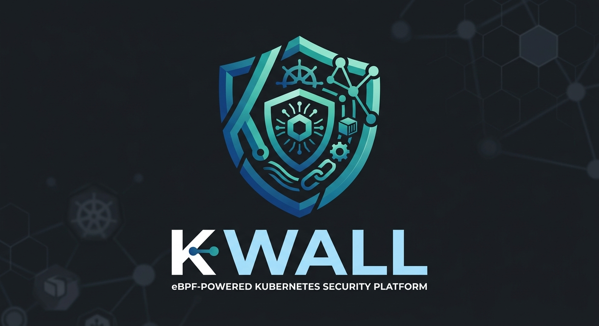

<div align="center">



# KWALL

### Cloud-Native Kubernetes eBPF Zero-Trust Security Platform

[](https://github.com/msaeedb40/kwall/actions/workflows/ci.yaml)
[](https://github.com/msaeedb40/kwall/actions/workflows/helm.yaml)
[](https://github.com/msaeedb40/kwall/actions/workflows/security.yaml)
[](https://www.rust-lang.org/)
[](https://aya-rs.dev/)
[](https://kubernetes.io/)
[](https://gateway-api.sigs.k8s.io/)
[](LICENSE)

<p align="center">
  <strong>High-performance kernel-level runtime security, container sandboxing, wire-speed micro-segmentation, and L7 WAF protection without sidecars.</strong>
</p>

[Architecture](docs/architecture.md) • [eBPF Hook Matrix](docs/ebpf-probes.md) • [Policy Spec](docs/policy-spec.md) • [Deployment Guide](docs/deployment-guide.md) • [API Reference](docs/api-reference.md) • [Compliance](docs/compliance.md)

---

</div>

## 🛡️ What is KWALL?

**KWALL** is an enterprise-grade Kubernetes security platform engineered entirely in **Rust** and powered by **eBPF (Extended Berkeley Packet Filter)**. Operating directly within the Linux kernel, KWALL delivers sub-microsecond threat mitigation, process-level container sandboxing, and real-time application security without relying on sidecar proxies or invasive user-space daemons.

### Why KWALL?

* **⚡ Wire-Speed Packet Drops (< 0.25µs)**: Pre-stack packet filtering via **XDP driver mode** absorbs SYN floods and mitigates DDoS attacks before socket allocation.
* **🔒 Zero-Overhead Sandboxing**: In-kernel **BPF LSM** hooks intercept unauthorized binary executions (`/bin/sh`, `/tmp/*`) and privilege escalations with zero syscall overhead.
* **🌐 Sidecar-Free L7 WAF**: Intercepts socket streams in kernel memory (`sk_msg`/`sk_skb`) to block SQLi, XSS, and SSRF attacks with atomic socket termination.
* **🔍 Cleartext TLS Inspection**: Dynamic uprobes hook userspace cryptographic libraries (`libssl.so`, `rustls`, Go `crypto/tls`) to inspect plaintext payloads without TLS proxy certificates.
* **📊 Multi-Factor Risk Scoring**: Continuously evaluates workload risk (0–100) combining runtime behavioral drift, SBOM CVE findings, and network exposure.
* **📜 Tamper-Evident Audit Ledger**: Every administrative action, policy change, and pod quarantine is chained via sequential **SHA-256 digests**.
* **📋 Continuous Compliance Scorecards**: Automated audit verification against **CIS Kubernetes Benchmark v1.8**, **SOC 2 Type II**, and **PCI-DSS v4.0**.
* **🕸️ Modern Management Console**: Single-pane-of-glass dashboard with interactive SVG topology, real-time alert triage, and visual policy construction protected by anti-CSRF guards.

---

## 🏛️ System Architecture

```
+-----------------------------------------------------------------------------------------+
|                                    KWALL CONTROL PLANE                                  |
|                                                                                         |
|  [ Web Management Console ]     [ Unified GraphQL Gateway ]     [ OpenAPI v3 REST API ] |
|  (Topology / Alert Triage)     (Hierarchical Multi-Cluster)     (SIEM & SOAR Pipelines) |
|               \                             |                             /             |
|                v                            v                            v              |
|              +---------------------------------------------------------------+          |
|              |                  Kubernetes Gateway API (v1)                  |          |
|              |                 (HTTPRoute / TLS Termination)                 |          |
|              +---------------------------------------------------------------+          |
+---------------------------------------------|-------------------------------------------+
                                              |
                                              v
+-----------------------------------------------------------------------------------------+
|                                KUBERNETES WORKER NODES                                  |
|                                                                                         |
|  +-----------------------------------------------------------------------------------+  |
|  |                            USERSPACE NODE AGENT (Rust)                            |  |
|  |  +------------------+  +------------------+  +---------------------------------+  |  |
|  |  |   Event Router   |  | Detection Engine |  | Risk Engine & MITRE ATT&CK Maps |  |  |
|  |  +------------------+  +------------------+  +---------------------------------+  |  |
|  |  +------------------+  +------------------+  +---------------------------------+  |  |
|  |  |  Threat Intel    |  | Forensics Engine |  |    Application Security (WAF)   |  |  |
|  |  +------------------+  +------------------+  +---------------------------------+  |  |
|  +-------------------------^--------------------^-------------------^----------------+  |
|                            |                    |                   |                   |
|                   BPF Ring Buffers      BPF Ring Buffers     BPF Sockmap (sk_msg)       |
|                            |                    |                   |                   |
|  +-------------------------v--------------------v-------------------v----------------+  |
|  |                                  LINUX KERNEL                                     |  |
|  |  [ XDP Driver Fast-Path ]  ===> Wire-speed L3/L4 packet filtering & DDoS drop     |  |
|  |  [ TC Ingress / Egress  ]  ===> Namespace micro-segmentation & DNS auditing       |  |
|  |  [ BPF LSM Security     ]  ===> Process execution sandbox & FIM file protection   |  |
|  |  [ Socket sk_msg/sk_skb ]  ===> Kernel socket stream HTTP/gRPC WAF inspection     |  |
|  |  [ Uprobe TLS Intercept ]  ===> Plaintext TLS inspection (OpenSSL, Rustls, Go)    |  |
|  +-----------------------------------------------------------------------------------+  |
+-----------------------------------------------------------------------------------------+
```

---

## 🚀 Quickstart

### 1. Prerequisites
* Linux Kernel **5.15+** with BTF (`CONFIG_DEBUG_INFO_BTF=y`) and LSM (`CONFIG_BPF_LSM=y`).
* Kubernetes cluster **v1.28+** with [Gateway API](https://gateway-api.sigs.k8s.io/) installed.
* Helm **v3.12+**.

### 2. Install via Helm
```bash
# Add KWALL Helm repository (or use local path)
helm repo add kwall https://charts.kwall.io
helm repo update

# Install KWALL with Gateway API and Web Dashboard
helm upgrade --install kwall deployments/helm/kwall \
  --namespace kwall-system \
  --create-namespace \
  --set api.enabled=true \
  --set dashboard.enabled=true \
  --set gatewayApi.enabled=true \
  --set gatewayApi.gatewayClassName=cilium
```

### 3. Verify Rollout
```bash
# Verify DaemonSet agent is running on all nodes
kubectl rollout status daemonset/kwall-agent -n kwall-system

# Verify Gateway API routes
kubectl get gateway,httproute -n kwall-system
```

---

## 🛡️ Policy Authoring (`KwallSecurityPolicy`)

Declare defense-in-depth policies spanning network, WAF, and host process sandboxing in a single Kubernetes custom resource:

```yaml
apiVersion: kwall.security/v1alpha1
kind: KwallSecurityPolicy
metadata:
  name: payment-backend-shield
  namespace: production
spec:
  selector:
    matchLabels:
      app: payment-service
  enforcementPlane: L7_WAF
  action: Drop
  rules:
    ingress:
      - protocol: HTTPS
        ports:
          - 8443
        waf:
          sqliProtection: true
          xssProtection: true
          ssrfProtection: true
    egress:
      - protocol: TCP
        toCIDR:
          - 10.244.0.0/16
    hostSandbox:
      deniedExecutables:
        - /bin/sh
        - /bin/bash
        - /usr/bin/nc
        - /tmp/*
      readOnlyPaths:
        - /etc
```

---

## 📦 Repository Structure

```text
kwall/
├── .github/workflows/          # CI/CD, Helm lint, security audits, and release pipelines
├── agents/
│   └── kwall-agent/            # Node agent orchestrating eBPF loader and event streaming
├── api/
│   └── graphql/                # Async multi-cluster GraphQL & OpenAPI v3 REST gateway
├── cli/                        # kwall CLI tool for probe inspection and triage
├── crates/
│   ├── kwall-core/             # Core primitives, memory safety, and types
│   ├── kwall-common/           # Shared types between kernel and userspace
│   ├── kwall-policy/           # Policy engine, parser, and verifier
│   ├── kwall-enforcement/      # TC, XDP, and LSM enforcement reconcilers
│   ├── kwall-telemetry/        # Prometheus metrics and ring-buffer statistics
│   ├── kwall-api/              # REST & gRPC server, enterprise RBAC, and compliance
│   ├── kwall-l7/               # L7 protocol parsers and RFC 1321 / SHA-256 crypto
│   ├── kwall-sbom/             # Software Bill of Materials & File Integrity Monitoring
│   ├── kwall-forensics/        # Incident timeline reconstruction & audit hash chaining
│   ├── kwall-threat-intel/     # MISP, STIX2, and AlienVault OTX feeds
│   ├── kwall-selfprotect/      # eBPF probe integrity guards and anti-tamper scanner
│   ├── kwall-federation/       # Multi-cluster peer sync & cross-cluster policy mesh
│   └── kwall-cri/              # Containerd & CRI-O seccomp profile generator
├── services/
│   ├── detection-engine/       # Sigma and behavioral threat detection engine
│   ├── risk-engine/            # Multi-factor workload risk scoring (0-100)
│   ├── event-processing/       # Stream event aggregator and enrichment pipeline
│   └── application-security/   # In-kernel WAF inspection and regex pattern matcher
├── ebpf/                       # #![no_std] Rust Aya kernel programs (XDP, TC, LSM, sk_msg)
├── deployments/
│   ├── crds/                   # KwallSecurityPolicy CRD manifests
│   ├── dashboard/              # Interactive single-pane-of-glass management console
│   ├── docker/                 # Multi-stage Dockerfiles for agent, operator, api, dashboard
│   ├── helm/kwall/             # Production Kubernetes Helm chart (Gateway API)
│   └── kind/                   # Local KinD cluster configuration
└── docs/                       # Comprehensive architectural & operational documentation
```

---

## 📚 Documentation Directory

* 📘 [Architecture Blueprint](docs/architecture.md) — Detailed subsystem topology, event flows, and kernel-to-userspace bridge.
* ⚡ [eBPF Kernel Probes](docs/ebpf-probes.md) — Comprehensive kernel hook matrix, map data structures, and verifier constraints.
* 🛡️ [Security Policy Guide](docs/policy-spec.md) — CRD schema reference and production policy examples.
* 🚀 [Deployment Guide](docs/deployment-guide.md) — Helm installation, KinD setup, and CLI reference.
* 🔌 [API Reference](docs/api-reference.md) — GraphQL schema queries, OpenAPI REST endpoints, and gRPC protos.
* 📋 [Compliance & Audit](docs/compliance.md) — CIS Kubernetes Benchmark, SOC 2 Type II, PCI-DSS v4.0, and SHA-256 audit chaining.

---

## 📄 License

KWALL is licensed under the [Apache License, Version 2.0](LICENSE).
