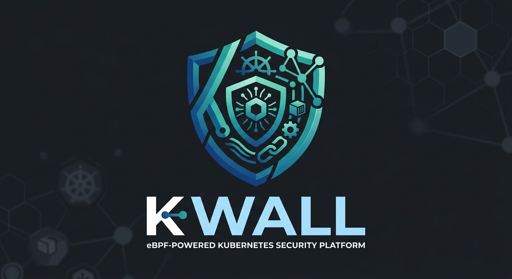

<p align="center">
  
</p>

# KWALL

> **eBPF-powered Kubernetes Firewall & Multi-Layer Security Platform**

KWALL is a cloud-native security engine written in Rust 1.99+ with Aya and Linux netkit. It provides L3–L7 packet filtering, runtime BPF LSM sandboxing, volumetric DDoS mitigation, and zero-copy flow observability directly in the Linux kernel without sidecars.

---

## Documentation

Full architectural and technical documentation is available in the [`oocs/`](file:///home/mb0/Documents/mylabdrive2/kwall/oocs) directory:

- [Documentation Index](file:///home/mb0/Documents/mylabdrive2/kwall/oocs/index.md)
- [Architecture & Design](file:///home/mb0/Documents/mylabdrive2/kwall/oocs/architecture.md)
- [Linux Kernel Compatibility & Requirements](file:///home/mb0/Documents/mylabdrive2/kwall/oocs/kernel-requirements.md)
- [Workspace Components Breakdown](file:///home/mb0/Documents/mylabdrive2/kwall/oocs/components.md)
- [Custom Resource Definitions (CRDs) & Policy Engine](file:///home/mb0/Documents/mylabdrive2/kwall/oocs/crds-and-policies.md)
- [Dataplane & Netkit Integration](file:///home/mb0/Documents/mylabdrive2/kwall/oocs/dataplane-and-netkit.md)
- [Threat Model & Security Capabilities](file:///home/mb0/Documents/mylabdrive2/kwall/oocs/threat-model-and-security.md)
- [CLI Reference Manual](file:///home/mb0/Documents/mylabdrive2/kwall/oocs/cli-reference.md)
- [Deployment & Operations Guide](file:///home/mb0/Documents/mylabdrive2/kwall/oocs/deployment-and-operations.md)
- [Observability, Metrics & Telemetry](file:///home/mb0/Documents/mylabdrive2/kwall/oocs/observability-and-telemetry.md)

---

## Quick Start

### Build
```bash
make check
make build
make ebpf
```

### Deploy to Kubernetes
```bash
helm install kwall deploy/helm/kwall --namespace kwall-system --create-namespace
```

---

## License

Apache-2.0